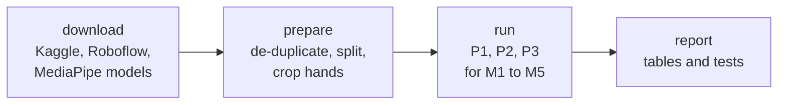

# Auslan fingerspelling recognition

Code for the UTS 42177 *Image Processing and Pattern Recognition* project (Group 9). It answers
the question set in the Task 1 report:

> How well do methods trained on one-handed **ASL** transfer to the two-handed **Auslan**
> alphabet, and does ASL training reduce the number of Auslan examples a method needs?

Five method families are trained and tested under one shared pipeline, so differences in the
results come from the methods and not from data handling.

| ID | Method | Registry names |
|----|--------|----------------|
| M1 | Skin / edge-map segmentation, shape features (Hu moments, convexity), kNN or SVM | `m1_skin_svm`, `m1_skin_knn` |
| M2 | HOG, PCA, SVM or random forest | `m2_hog_svm`, `m2_hog_rf` |
| M3 | Four-block CNN from random weights | `m3_cnn` |
| M4 | ImageNet-pretrained MobileNetV2 / ResNet-18, fine-tuned | `m4_mobilenetv2`, `m4_resnet18` |
| M5 | MediaPipe 2 x 21 hand landmarks, SVM / random forest / MLP | `m5_landmarks_svm`, `m5_landmarks_rf`, `m5_landmarks_mlp` |

## How it works



More diagrams (layers, the method interface, the three protocols, one run step by step, files on
disk) are in [docs/ARCHITECTURE.md](docs/ARCHITECTURE.md).

## Quick start

```bash
uv sync                                  # Python 3.12 environment, see docs/SETUP.md
uv run auslan download                   # Kaggle datasets + MediaPipe models (about 7.2 GB)
export ROBOFLOW_API_KEY="<your key>"     # free account; needed for the independent test set
uv run auslan download --roboflow        # Roboflow Auslan test set
uv run auslan prepare                    # de-duplicate, split, crop hands, cache landmarks
uv run auslan run E1 --dry-run           # list the planned runs
uv run auslan run E1                     # headline experiment: all methods, P1 / P2 / P3
uv run auslan speed                      # time hand detection and cropping
uv run auslan report                     # tables under artifacts/report/
```

- Runs are **resumable**: finished runs are skipped, so an interrupted `auslan run` can simply be
  started again. `--methods`, `--seeds` and `--protocols` narrow a run, for example
  `auslan run E1 --protocols P1` before the Roboflow data is available.
- P2 and P3 need the Roboflow test set. Everything else (P1, `prepare`, the unit tests) works
  without it.
- `uv run auslan methods` lists the method names.

## Protocols and experiments

| Protocol | Train | Test |
|----------|-------|------|
| P1 | ASL Alphabet (24 letters) | held-out ASL split and ASL Alphabet Test |
| P2 | `k` Kaggle Auslan images per letter, learned from scratch (M4 keeps its ImageNet weights) | held-out Kaggle split and Roboflow Auslan |
| P3 | as P2, but starting from the weights learned on ASL (new 26-class output layer) | as P2 |

Hand-crafted methods (M1, M2, M5 SVM/RF) cannot reuse ASL training, so for them P3 equals P2 and
the runner skips it. The experiments of the report's Table 7 live in `src/auslan/experiments.py`:

| ID | Command | What it runs |
|----|---------|--------------|
| E1, E2 | `auslan run E1` | every method under P1, P2, P3 at k=20 (and P2/P3 on all data once); same-dataset against cross-dataset scores come from the same runs |
| E3 | `auslan run E3` | the k curve: 5, 10, 20, 50 and all |
| E4 | `auslan report` | per-letter F1 and the most confused letter pairs, from saved predictions |
| E5 | `auslan run E5` | design alternatives: HOG cell size and kernel, kNN, random forests, landmark contact features, CNN depth and augmentation, frozen backbones |
| E6 | `auslan run E1` | every P2/P3 run is also scored on Roboflow without the style transform |
| E7 | `auslan run E7` | input size 224 / 64 / 32 against the default 128 |

`auslan report` writes these files to `artifacts/report/`:

| File | Content |
|------|---------|
| `table9.md` | the Task 2 results template with 95% bootstrap intervals |
| `cost.md` | training time, model size, CPU time per frame |
| `cross_dataset.md`, `style_effect.md`, `image_size.md`, `variants.md` | E2, E6, E7 and E5 |
| `k_curve.csv` | E3 |
| `per_letter_f1.csv`, `confused_pairs.md`, `confusion_<method>.csv` | E4 |
| `significance.md` | McNemar with Holm correction, paired bootstrap of F1 differences, ΔT for ASL training |
| `success_criteria.md` | S1 to S4 checked against the targets |
| `detection_rates.md` | how often MediaPipe finds hands, and how often M1 finds none |

## Layout

```
src/auslan/
  data/           label spaces, catalog, de-duplication, splits, prepared sample sets, downloads
  preprocessing/  hand cropping, MediaPipe adapters, skin-colour mask
  methods/        the five families behind one Classifier interface and a name registry
  evaluation/     metrics, McNemar / Holm / bootstrap, timing
  runner.py       one run under P1, P2 or P3
  experiments.py  E1 to E7 as lists of runs
  report/         result tables
  cli.py          the `auslan` command
tests/            unit tests and a toy end-to-end run on synthetic data
docs/             setup, datasets, architecture, related work
```

## Design notes

- **One interface.** A method provides `fit(train, val, init)` and `predict_proba`. The runner,
  metrics and report do not know which family they handle; a new method is one decorated function.
- **No leakage.** Exact and near-duplicate images (perceptual hash) are removed before splitting,
  and each test set is cleaned of images that nearly match its training set. Test sets are never
  used for tuning; early stopping and the classical methods' hyper-parameters use only 10
  validation images per letter.
- **Hands are never flipped.** A flip would swap the two hands, so augmentation uses small
  rotations, crops and colour jitter only. Hands are ordered by wrist position, not by the
  detector's left/right label.
- **Failures are measured, not hidden.** Each image's hand count and fallback use are stored in
  `catalog.csv` and summarised in `detection_rates.md`.

## Differences from the report

The report is the specification; these are the places where reality or a deliberate choice
differs, so they can be reported honestly.

| Topic | What the code does | Why |
|-------|--------------------|-----|
| Image size | CNNs read 128 x 128 crops by default; E7 covers 224, 64, 32 | the report's risk register allows it for laptop-sized training |
| Amount of data | the near-duplicate step (4 of 64 hash bits) leaves about 16,980 ASL images and 11,913 Kaggle Auslan images, so "all data" is roughly 320 images per letter instead of 1,400 | consecutive video frames are nearly identical; keeping them would leak between splits |
| M5 on Kaggle drawings | MediaPipe finds no hand in the binarised Kaggle images, so M5 is reported under P1 only | the case the report's risk register describes; `detection_rates.md` has the numbers |
| M1 on Roboflow | its headline test uses the colour photo ("Roboflow before T" in the report); the other methods see the styled image | skin thresholds need colour |
| Not implemented | M1 adaptive thresholds and one-versus-two-region masks, M2 full-frame input, M4 nearest-class-mean, the OpenPose fallback, example images for S5, the check of crops against the Roboflow boxes | optional alternatives in the report; E5 covers the others |

## Development

```bash
uv run pytest                  # unit tests; the toy end-to-end tests take a few minutes
uv run ruff check src tests
uv run ruff format src tests
```

Datasets and where to get them: [docs/DATASETS.md](docs/DATASETS.md). Setup, credentials and
troubleshooting: [docs/SETUP.md](docs/SETUP.md). Related repositories and what was taken from
them: [docs/RESEARCH.md](docs/RESEARCH.md).
