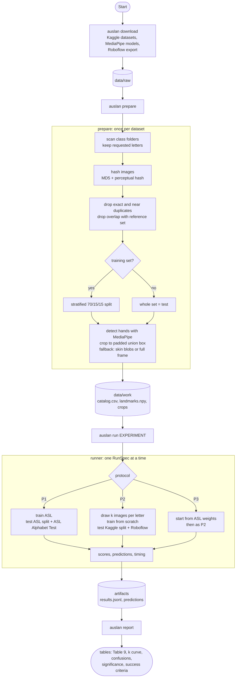
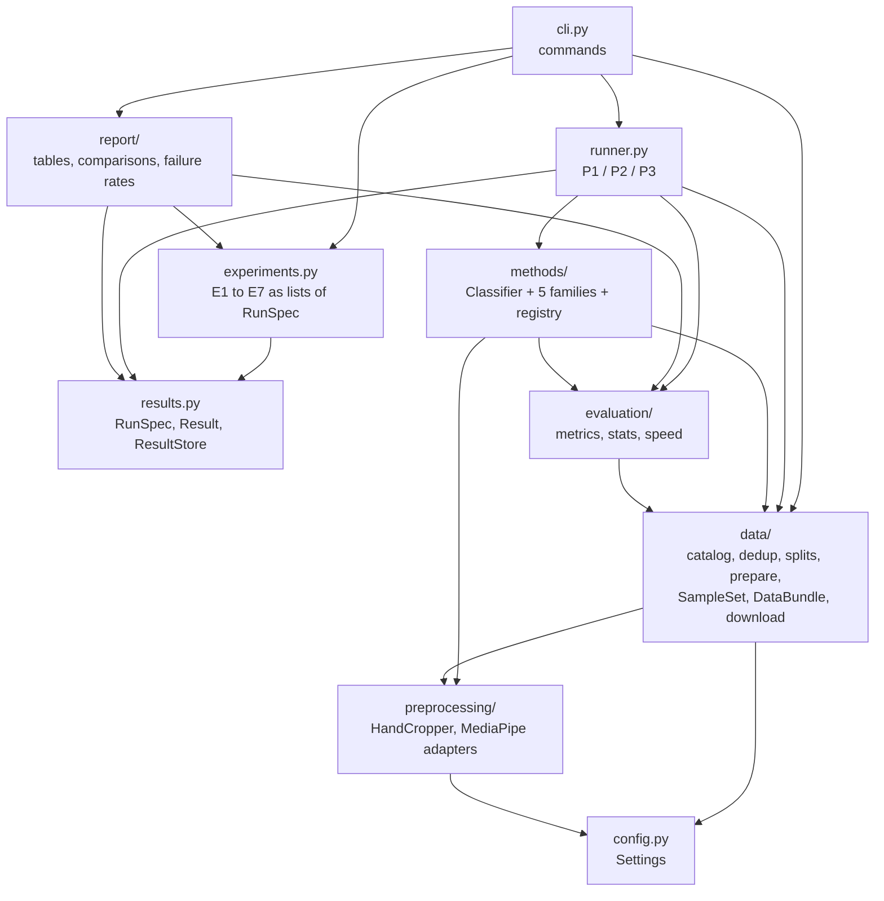
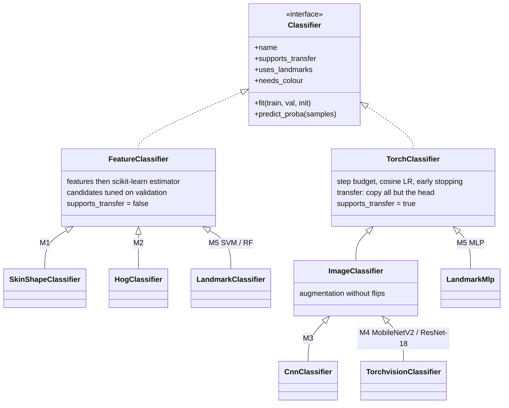
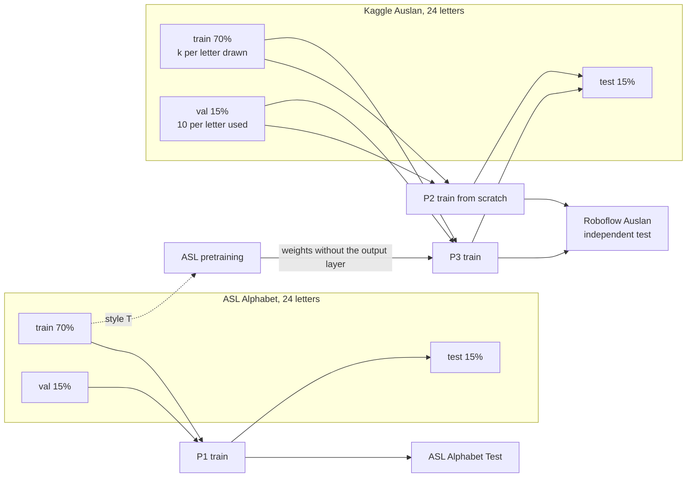
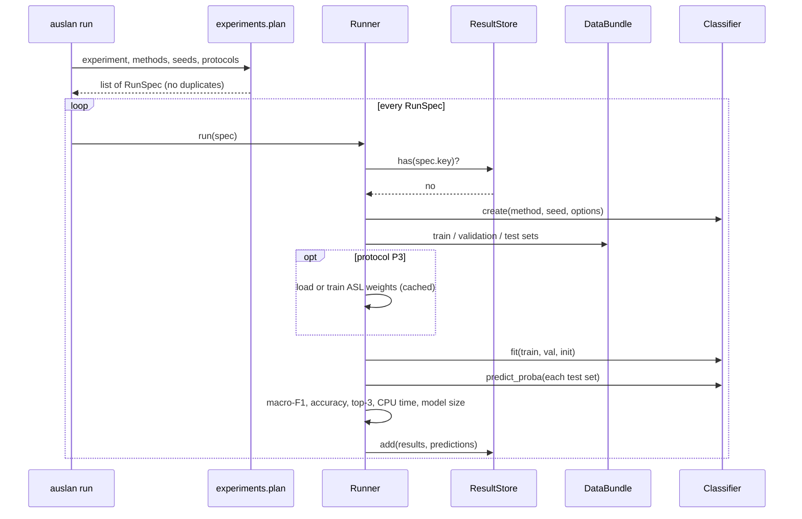

# Architecture

This page shows how the code is organised and how data flows through it. All diagrams are
[Mermaid](https://mermaid.js.org/) and render on GitHub and in most Markdown viewers.

## 1. End-to-end flow

From a clean checkout to the tables of the Task 2 report. Each box is one command or module;
everything in the "disk" column is cached, so any step can be repeated or resumed.



## 2. Layers and dependencies

Arrows point from a module to what it depends on. Nothing in a lower layer imports from a higher
one, so each layer can be tested without the ones above it.



| Layer | Responsibility | Knows nothing about |
|-------|----------------|---------------------|
| `config` | immutable `Settings`, YAML overrides | everything else |
| `preprocessing` | find hands, crop, fallback regions | datasets, methods |
| `data` | turn raw folders into prepared sample sets | methods, protocols |
| `methods` | `fit` / `predict_proba` for the five families | protocols, datasets |
| `evaluation` | metrics, significance tests, timing | which method produced a prediction |
| `runner`, `experiments` | what to train on and test on, in which order | how a method works inside |
| `report`, `cli` | present results, run commands | training details |

## 3. The method interface

Every method hides behind one small interface, so the runner treats all of them the same way.
`supports_transfer` tells the runner whether protocol P3 applies, `uses_landmarks` lets it skip
M5 where MediaPipe finds no hands, and `needs_colour` keeps M1 on the colour photo.



Methods are looked up by name from a registry (`methods/base.py`), so adding one is a single
decorated function and nothing else changes:

```python
@register("my_method", seeded=True)
def _my_method(**options) -> MyClassifier:
    return MyClassifier("my_method", **options)
```

## 4. The three protocols



P2 and P3 differ only in the starting weights: the same drawn images, validation images, seed,
step budget and test sets. Hand-crafted methods cannot reuse ASL training, so for them P3 is P2
and the runner skips it.

## 5. One run in detail



## 6. Files on disk

```
data/                       git-ignored
  raw/<dataset>/            downloaded, untouched
  models/                   MediaPipe hand and face models
  work/<dataset>/
    hashed.csv              paths with MD5 and perceptual hashes (cache of the slow step)
    chunks/*.npz            crop results per 2,000 images (resume point)
    crops/*.jpg             224 px hand crops
    landmarks.npy           (N, 2, 21, 3) hand landmarks, zero where a hand was not found
    settings.json           what the dataset was built with; mismatches are refused
    catalog.csv             one row per image: path, label, split, n_hands, used_fallback, ...
artifacts/                  git-ignored
  results.jsonl             one line per run and test set
  predictions/*.npz         labels and class probabilities of every run
  pretrained/*.joblib       ASL-trained weights that P3 starts from
  crop_ms.json              hand detection time per frame
  report/                   the tables written by `auslan report`
```

## 7. Design decisions worth knowing

- **Leakage first.** Duplicates are removed before splitting, test sets never influence tuning,
  and the overlap of a test set with its training set is removed from the test set.
- **Same pipeline for everyone.** Hands are cropped once; M1 to M4 read the cached crop and M5
  reads the cached landmarks, so differences between methods are not data-handling differences.
- **Failures are visible.** Per-image hand counts and fallback use are stored in the catalog and
  summarised by the report. M5 is skipped, with a warning, where training images contain no
  detected hands (the report's risk register anticipates this for the Kaggle drawings).
- **Small, replaceable parts.** Detectors, fallbacks and methods are passed in or looked up by
  name, so tests use tiny fakes and new variants need no changes to the runner.
